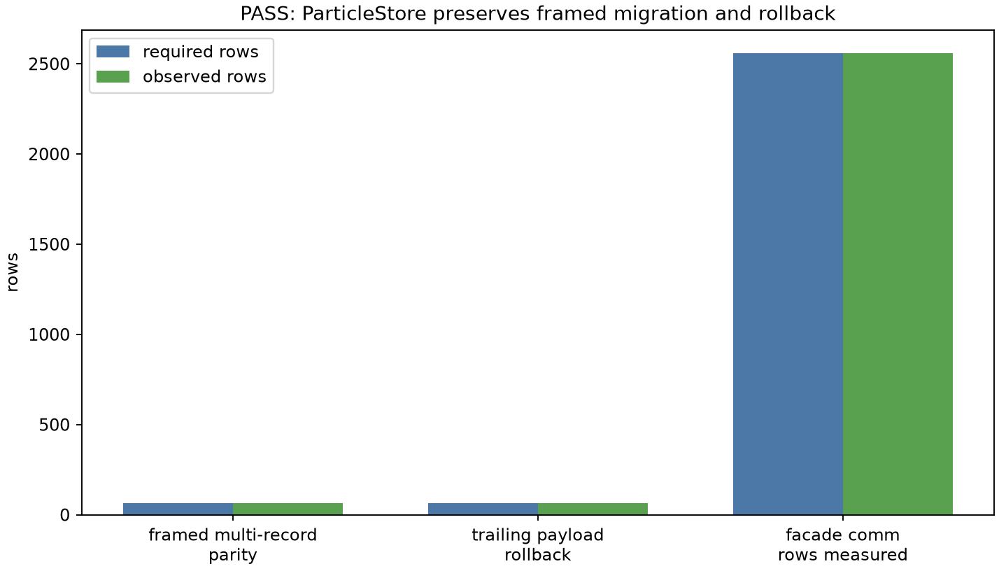
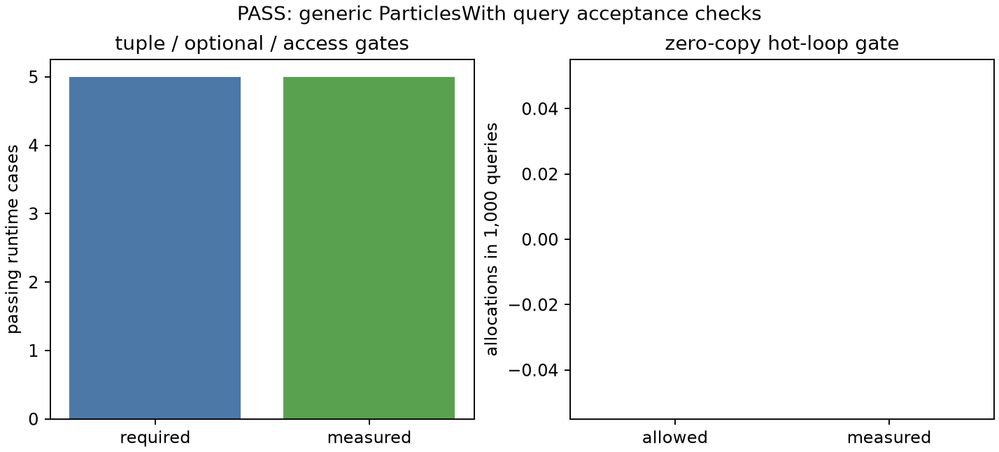
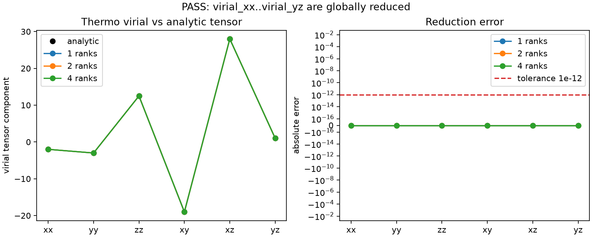
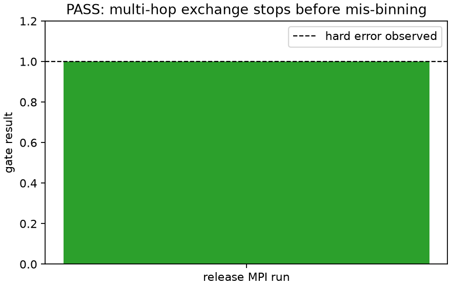
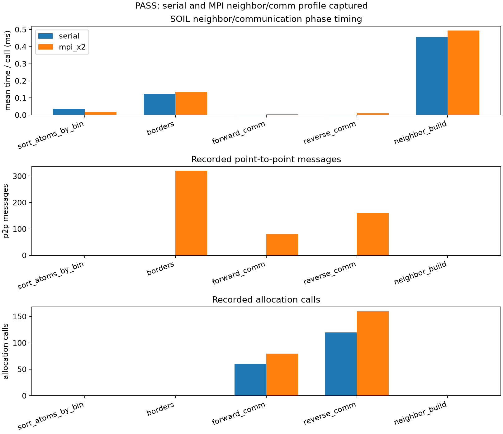
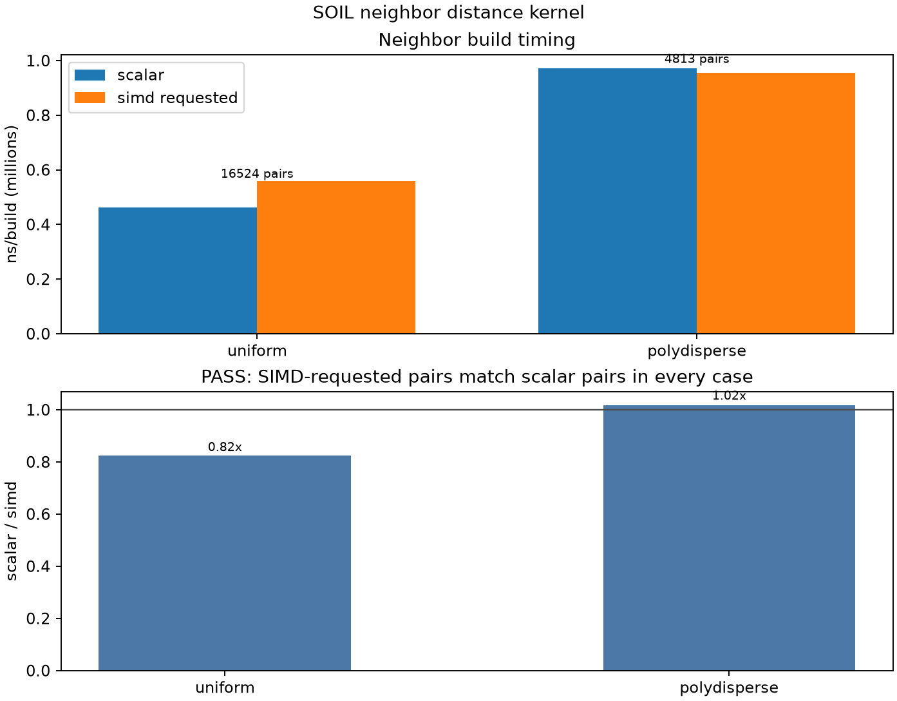
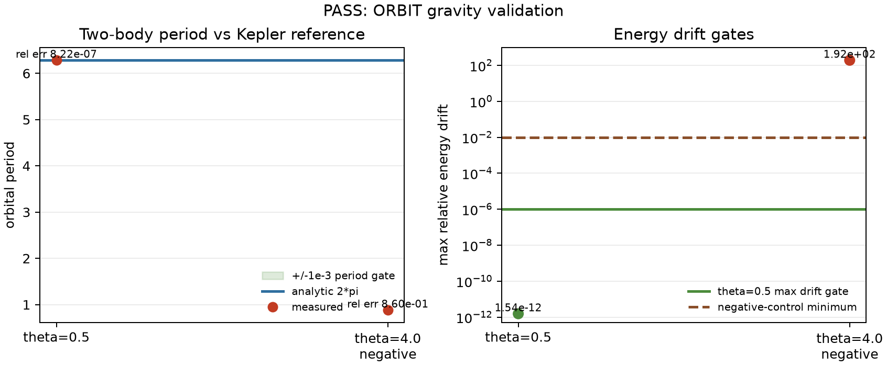
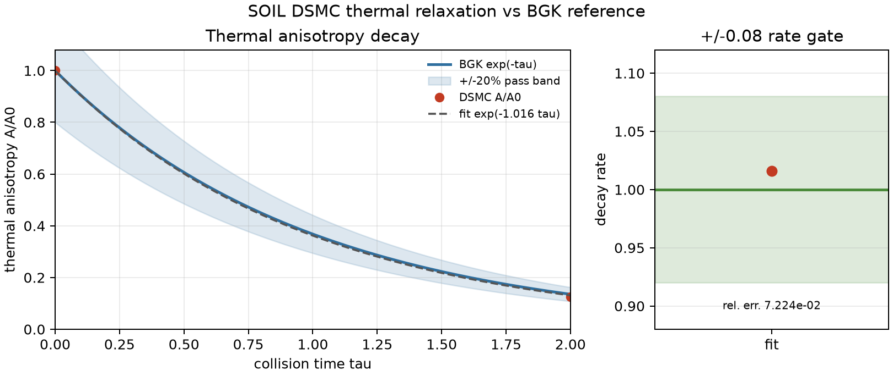

# SOIL Validation Examples

Validation examples live under top-level `examples/`, matching the DIRT layout.
Crate directories contain library code only.

## atomdata_row_contract

Exact row-count contract validation for late extension registration and a
malformed manual multi-column store. The accepted store must have three rows;
the malformed store's hidden two-row column must be rejected.

## particle_store_facade

Executable validation and measured representative communication path for the
new synchronized `ParticleStore` facade.  It checks transactional local
construction, exact core-plus-extension parity for a framed multi-record
migration, and all-or-nothing rollback for a trailing-payload failure.

## particleswith_queries

Generic `ParticlesWith` typed extension-query validation: tuple order and
mutability, optional data, preparation errors, scheduler resource access, and
a zero-allocation hot-loop guard.

## virial_thermo_crossrank

MPI validation that `VirialStress` pair-force contributions reach the
`soil_print` thermo columns through a global reduction. The same declarative
pair-force tensor is checked against the analytic result on 1, 2, and 4 ranks.

## overlap_forward_validate

MPI validation that overlapped forward communication matches the baseline path
to the FP floor on 1, 2, and 4 ranks while doing measured interior work before
boundary work. The same sweep compares opt-in f32 forward ghost position/velocity
communication against the default f64 path.

## exchange_multihop_gate

MPI release-build validation that a required two-rank atom migration stops with
a hard, actionable exchange error instead of leaving a local atom outside its
owner subdomain.

## polydisperse_neighbor_rebuild

Mixed-radius neighbor-list validation against an independent brute-force pair
set on 1, 2, and 4 MPI ranks. It checks that polydisperse SOIL neighbor lists
keep every valid pair while allowing per-atom rebuild budgets.

## neighbor_comm_profile

Performance harness that records timing, allocation, and communication counters
for SOIL border exchange, forward/reverse communication, atom sorting, and
neighbor-list build phases on checked-in serial and MPI layouts.

## neighbor_hot_path

Validation and microbenchmark for the neighbor distance kernel. Checked-in
uniform and polydisperse layouts compare SIMD-requested neighbor pairs against
the scalar pair set, then report per-build timing.

## tree_farfield_proof

Octree near/far partition and far-field proof against brute-force references:
exact near pairs, convergent `1/r` treecode accuracy, and sub-quadratic
interaction-count scaling.

## orbit_nbody_gravity

ORBIT octree gravity demonstration checked against the analytic two-body
Kepler period, a max-energy-drift tolerance, and a theta `4.0` negative
control.

## dsmc_thermal_relaxation

Homogeneous Maxwell-molecule DSMC thermal-relaxation check against the BGK
`exp(-tau)` anisotropy decay reference, with the stochastic final-ratio and
fitted-rate gates shown in the committed figure.

