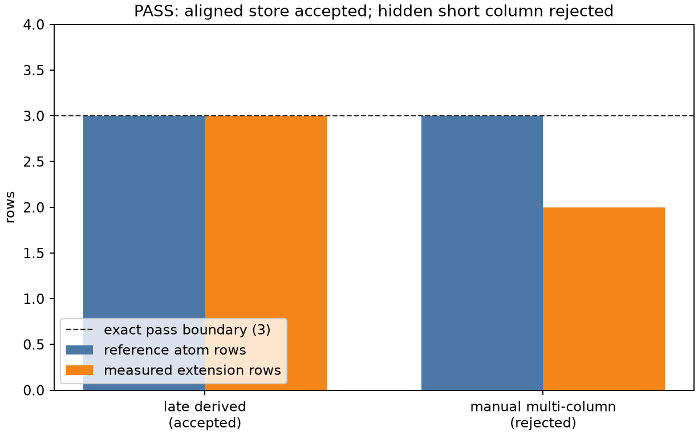

# atomdata_row_contract

This executable validation checks the exact one-row-per-atom registration
contract. It registers an empty derived two-column store after three atoms and
checks that default backfill produces three rows in both columns. It then tries
to register a manual two-column store whose primary column has three rows but
whose hidden vector column has two; registration must reject it.

Run from the repository root:

```sh
python3 examples/atomdata_row_contract/sweep.py
```



PASS means the accepted store matches the exact three-atom reference and the
malformed custom multi-column store is rejected before communication can index
its short column.
