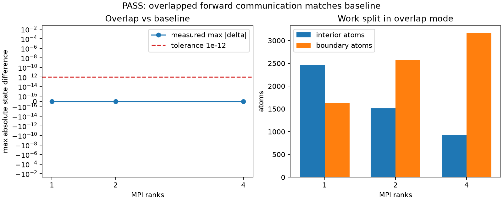
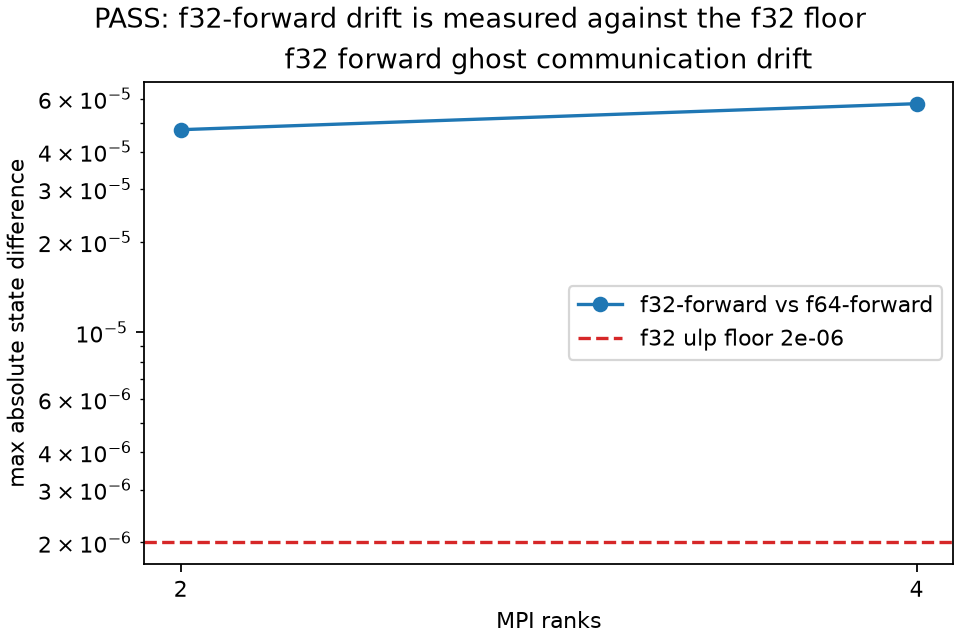

# overlap_forward_validate

MPI validation that `soil_core::forward_comm_overlap` produces the same final
state as the non-overlapped forward communication path while doing real interior
work before the boundary force. The same sweep also compares the explicit
`[comm] forward_precision = "f32"` path against the default f64 forward ghost
position/velocity path. The case is substrate-level and particle-method
agnostic: a Lennard-Jones gas is only the local force used to expose the
communication behavior.

Run the full validation sweep from the repository root:

```sh
python3 examples/overlap_forward_validate/sweep.py
```



The plot shows measured max state difference between overlap and baseline
against the `1e-12` tolerance, plus the measured interior/boundary work split.
PASS means every rank layout matches baseline to the FP floor and overlap mode
has non-empty ordered interior and boundary work.



The plot shows the opt-in f32-forward final-state drift against an f32 ulp-scale
reporting floor. The 300-step LJ gas measured `4.733e-05` on 2 ranks and
`5.778e-05` on 4 ranks, so f32 forwarding remains an explicit experiment rather
than the default.
