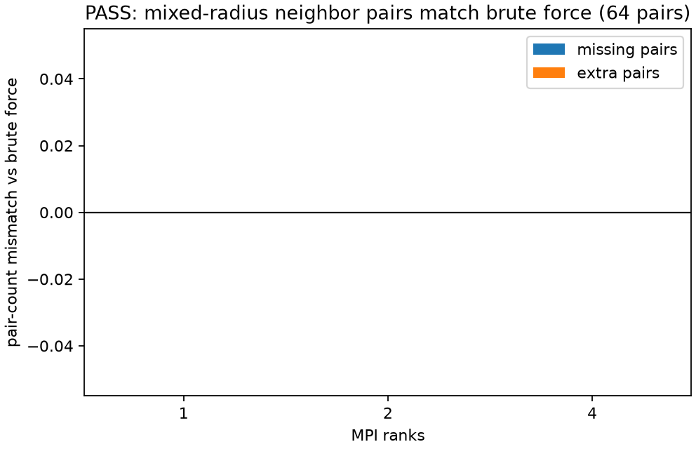

# polydisperse_neighbor_rebuild

This SOIL validation seeds a deterministic mixed-radius point cloud and compares
the neighbor-list pair set against an independent brute-force O(N^2) reference
on 1, 2, and 4 MPI ranks. The check exercises the polydisperse path where each
atom's rebuild budget is tied to its own cutoff radius.

```sh
python3 examples/polydisperse_neighbor_rebuild/sweep.py
```



PASS means every MPI layout reports exactly the same skinned neighbor pairs as
the brute-force mixed-radius reference: zero missing pairs and zero extra pairs.
