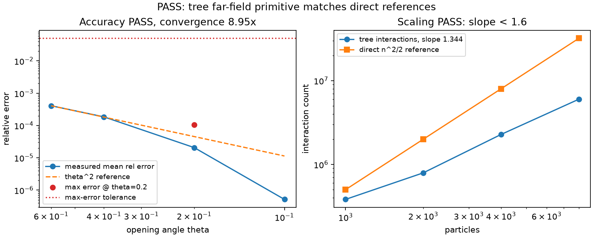

# tree_farfield_proof

Substrate-level proof that SOIL's octree primitives can support a long-range
particle method without baking one into the substrate. The example compares
near-pair partitioning with brute force, compares a monopole treecode with the
direct `1/r` sum, and checks sub-quadratic interaction-count scaling.

Run the full validation sweep from the repository root:

```sh
python3 examples/tree_farfield_proof/sweep.py
```



The plot shows measured treecode error against the theta-squared reference and
the `5e-2` max-error tolerance, plus measured tree interaction counts against
the direct `n^2/2` reference. PASS means the near/far partition is exact, the
treecode converges toward the direct sum, and the measured scaling exponent is
below 1.6.
