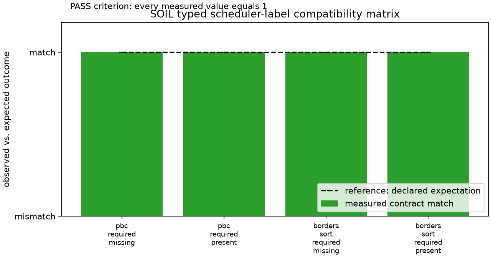

# typed_system_labels

This executable matrix verifies the required typed scheduler seams exported by
SOIL against the expectations in `config.toml`. A missing provider for `PBC`
or the `SORT_ATOMS -> BORDERS` seam must be rejected during schedule
organization; supplying that provider must be accepted. It compiles against
the exact reviewed Grass revision declared in the workspace manifest.

```sh
python3 examples/typed_system_labels/sweep.py
```



The committed run is **PASS (4/4)**: each measured scheduler outcome matched
the declared accept/reject contract, with the pass criterion shown in the
figure.
